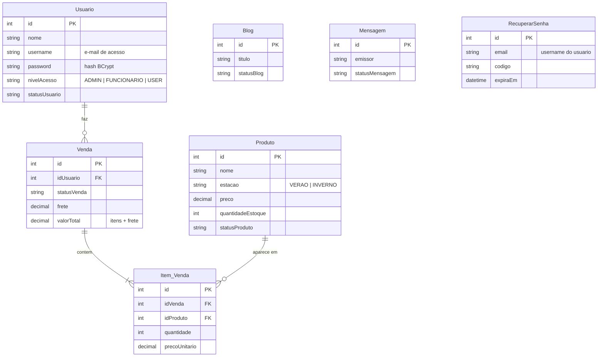

# Banco de dados - AuraViva (SQL Server / Somee)

Banco **SQL Server** com 7 tabelas, pronto para hospedar no **Somee**.

## Arquivos

| Arquivo | Para que serve |
|---|---|
| `bd_auraviva_sqlserver.sql` | **Script completo** (tabelas + dados de teste). O mais simples de usar. |
| `1_criar_tabelas_sqlserver.sql` | So a estrutura (7 tabelas). |
| `2_dados_iniciais_sqlserver.sql` | So os dados de teste (rode depois do 1). |
| `3_consultas_conferencia_sqlserver.sql` | Consultas para conferir se deu certo. |
| `mysql-antigo/` | Versao antiga do banco em MySQL (so para consulta). |

> O script completo e o 1 + o 2 juntos. Use **um dos dois caminhos**, nao os dois.

## Passo a passo no Somee

1. Entre no painel do Somee e crie o banco **SQL Server** (aba *Databases*).
2. Anote: **host** (ex.: `meubanco.mssql.somee.com`), **nome do banco**, **usuario** e **senha**.
3. Abra o banco no SSMS / Azure Data Studio (ou no editor de consultas do painel) e execute `bd_auraviva_sqlserver.sql`.
4. Execute `3_consultas_conferencia_sqlserver.sql` para conferir (devem aparecer 7 tabelas).
5. Copie `backend/.env.example` para `backend/.env` e preencha `DB_HOST`, `DB_NAME`, `DB_USER` e `DB_PASSWORD`.

> Os scripts **apagam e recriam as tabelas**. Rodar de novo zera o que foi cadastrado.
> Nao ha `CREATE DATABASE` nem `CREATE USER`: no Somee o banco e o login ja vem do painel.

## Usuarios de teste (senha de todos: `12345678`)

| E-mail | Nivel | Status |
|---|---|---|
| admin@auraviva.com.br | ADMIN | ATIVO |
| funcionario@auraviva.com.br | FUNCIONARIO | ATIVO |
| maria@email.com | USER (cliente) | ATIVO |
| joao@email.com | USER (cliente) | ATIVO |
| ana@email.com | USER (cliente) | INATIVO |

Troque essas senhas antes de publicar o site de verdade.

## Tabelas

`Blog`, `Mensagem` e `RecuperarSenha` nao tem chave estrangeira; `RecuperarSenha.email` corresponde ao `Usuario.username`.

## Problemas comuns

| Erro | O que fazer |
|---|---|
| `Login failed for user` no backend | Usuario/senha do `.env` diferentes dos do painel do Somee. |
| `The TCP/IP connection to the host ... has failed` | `DB_HOST` errado ou sem internet. Confira o host no painel. |
| `Invalid object name 'Usuario'` | O script nao foi executado nesse banco. |
| `Cannot open database` | `DB_NAME` diferente do nome real do banco no Somee. |